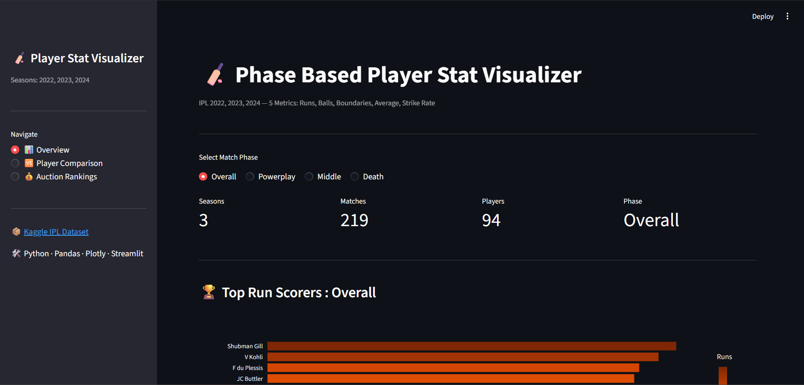
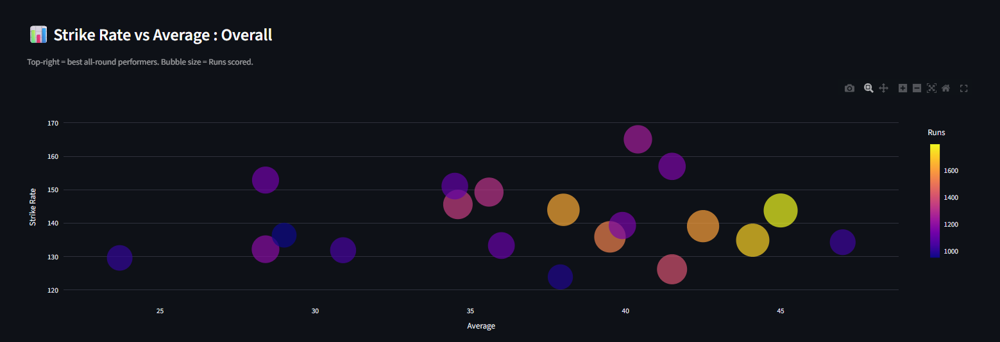
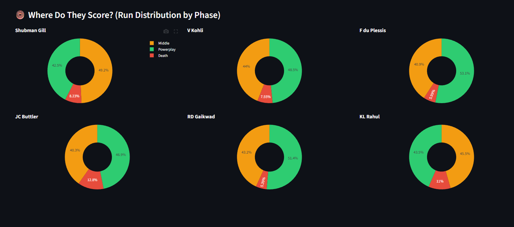
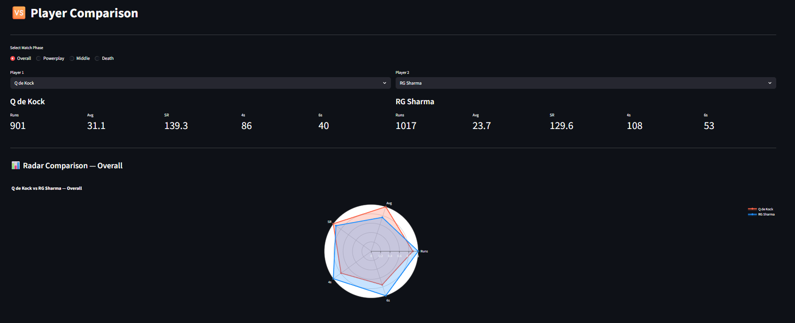
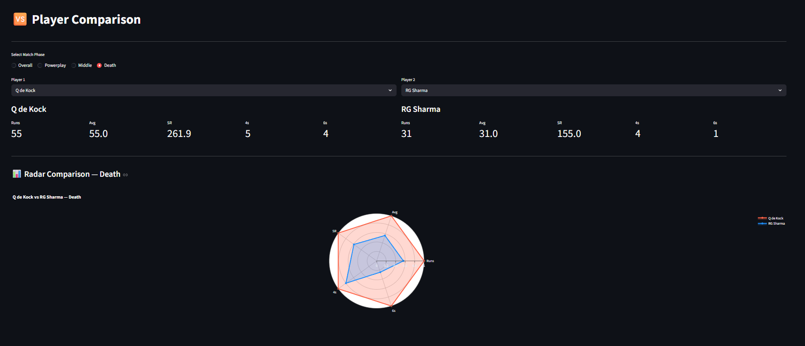
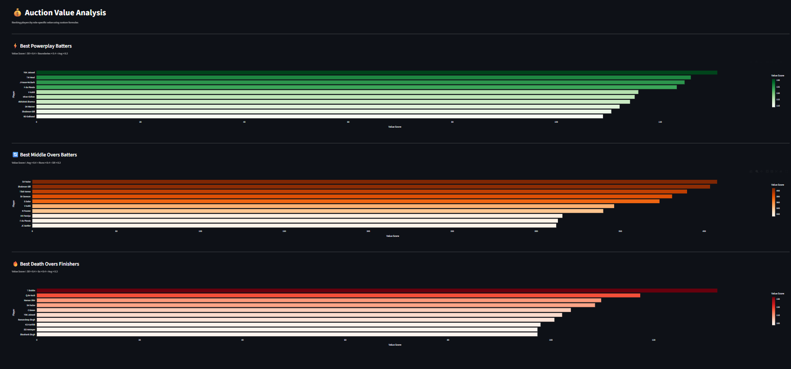

# Phase-Based Player Value Visualizer (IPL)

An interactive Streamlit dashboard that breaks IPL batting performance down by match phase: **Powerplay** (overs 1-6), **Middle** (overs 7-15) and **Death** (overs 16-20). Career totals hide the fact that a batter can dominate one phase and struggle in another; this tool lets you filter every chart by phase and rank players with a phase-specific value score.

Final project for EECE 5642 Data Visualization, Northeastern University.



## Features

- **Phase filter:** one radio selector re-filters the data and updates every chart at once.
- **Overview page:** top 15 run scorers, a strike rate vs. average bubble chart (bubble size = runs), and donut charts showing where each top player scores their runs.
- **Player comparison:** pick any two batters and compare Runs, Average, Strike Rate, 4s and 6s on a radar chart, normalized to a 0-1 scale.
- **Auction rankings:** the top 10 batters per phase by a custom value score.

## Data

[IPL Complete Dataset (2008-2024)](https://www.kaggle.com/datasets/patrickb1912/ipl-complete-dataset-20082020) from Kaggle:
- `matches.csv`: one row per match (teams, venue, season, winner)
- `deliveries.csv`: ball-by-ball data, more than 200,000 rows

The app joins the two files on match ID, keeps the 3 most recent seasons (2022-2024: 219 matches, 94 qualifying batters), and classifies each delivery into a phase by over number.

## Value score formulas

Each formula gives 40% weight to the two skills that matter most in that phase and 20% to a secondary metric.

| Phase | Formula | Rewards |
|---|---|---|
| Powerplay | SR x 0.4 + Boundaries x 0.4 + Avg x 0.2 | Aggressive starts, boundary hitting |
| Middle | Avg x 0.4 + Runs x 0.4 + SR x 0.2 | Consistency, building an innings |
| Death | SR x 0.4 + 6s x 0.4 + Avg x 0.2 | Power hitting, sixes |

## Key findings

- Rankings reshuffle completely by phase: openers lead the Powerplay, anchors lead the Middle overs, and finishers lead the Death overs, including players who barely appear in the overall top 15.
- Comparing Q de Kock and RG Sharma: Sharma leads overall in Runs and 4s, but in the Death overs de Kock's strike rate jumps to 261.9 vs. Sharma's 155.0 and the radar chart inverts.

| Strike rate vs. average | Run distribution by phase |
|---|---|
|  |  |

| Radar: Overall | Radar: Death overs |
|---|---|
|  |  |



## Run it locally

```bash
git clone https://github.com/Krishnaprasadselvaraj7/ipl-phase-visualizer.git
cd ipl-phase-visualizer
pip install -r requirements.txt
```

Download `matches.csv` and `deliveries.csv` from the Kaggle link above, place them in the same folder as `app.py`, then run:

```bash
streamlit run app.py
```

## Tech stack

Python, Pandas (data processing), Plotly (interactive charts), Streamlit (web interface, with `@st.cache_data` caching).

## Challenges

- **Data cleaning:** the season column mixed formats and had to be converted to numbers; team names changed across years (for example Delhi Daredevils to Delhi Capitals).
- **Radar normalization:** metrics sit on very different scales (runs in the hundreds, averages around 30-50), so each is normalized to 0-1 against the two players compared.
- **File paths:** Streamlit's working directory differed from the script location, solved with `os.path.abspath(__file__)`.

## Future work

Bowling analysis, venue-specific analysis, comparison with actual auction prices, season-over-season trends, and deployment to Streamlit Community Cloud.
